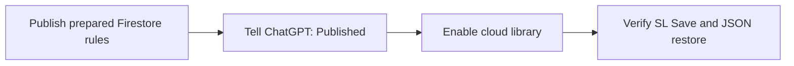

# Enable the family puzzle library

The puzzle library uses the existing Cloud Firestore database in `kidsgame-7a262`.
It stores one document per puzzle in `puzzleLibrary`.
SL and CJ can save and delete puzzles. Archive interface controls remain SL-only.
Approved family players can read puzzles.

## Activation status

Sean reports publishing the updated complete rules, including SL/CJ deletion and private progress.
The agent did not independently inspect the deployed rules. Cloud controls are enabled.
The prepared site cache is `kidsgames-v18`.
The live Firebase rules were not inspected directly.
Real Firebase Save and restore still need the check below.

## Required console step

1. Open [Firebase console for kidsgame-7a262](https://console.firebase.google.com/project/kidsgame-7a262/firestore).
2. Select **Firestore Database**.
3. Select **Rules**.
4. Keep a copy of the current rules.
5. Open the [complete prepared rules](https://raw.githubusercontent.com/seanlin-larc/kidsgames/main/firebase/firestore.rules).
6. Copy the complete file.
7. Replace the console editor contents with that file.
8. Select **Publish**.
9. Tell ChatGPT that the rules are published.

The prepared file includes the existing player, Minesweeper, and statistics rules.
The updated rules include `puzzleLibrary` permissions and private player completion records.
Do not replace the whole ruleset with only that new block.

The server permits puzzle creates and updates when `players/{uid}.code` is `SL` or `CJ`.
Both `SL` and `CJ` can delete library puzzles.
The existing player documents are maintained through the console.
Browser clients cannot change those documents.
No UID needs to be copied into the game code.

Cloud controls are enabled with `LIBRARY_ENABLED = true`.
Save keeps a device draft and attempts a cloud save when online.



## Existing settings

Use the existing `(default)` database.
Keep the existing Authentication, authorized domains, and API key settings.
The app reuses the existing signed-in Firebase session.
The first successful Save creates the collection and document automatically.

This design does not use Cloud Storage or a new backend service.
It does not need a service account key, GitHub credential, or GitHub configuration change.
Ordinary Firestore reads and writes remain subject to the project's quotas and billing plan.
Managed Firestore export is not used for the JSON archive.

## After activation

1. Sign in as SL on the game homepage.
2. Open Move The Red Locomotive.
3. Enter a puzzle name.
4. Select Save and a difficulty.
5. Check the **Puzzle saved** card.
6. Open Firestore Database → Data.
7. Check the new document in `puzzleLibrary`.

The confirmation card appears only after Firestore confirms the save.
It names the saved puzzle and stays open until dismissed.
If the later device copy fails, the card explains that separately.

Use **Open library** to load a saved puzzle on another signed-in device.
Use **New puzzle** to create a separate puzzle.
Saving a loaded puzzle updates its existing document.

### Manage library and delete duplicates

Publish the updated complete `firebase/firestore.rules` file before using deletion on the live site.
Earlier rules reject all puzzle deletions. The updated rule permits SL and CJ to delete library documents.
Player records and game statistics keep their existing protections.

1. Sign in as SL and select Build in the workshop.
2. Select **Manage library** on the controls card.
3. Select **×** beside the duplicate puzzle.
4. Check the puzzle name in the confirmation.
5. Confirm to delete, or cancel to keep the puzzle.

The list removes the entry only after Firestore confirms deletion.
The current board and device draft stay available.
The device's cached library removes the deleted entry.
A puzzle changed on another device requires reopening Manage library before deletion.
Failed or offline requests keep the entry and show an error.
Deletion does not queue an offline request or delete any other puzzle.

Use **Download archive** to download all saved puzzles as JSON.
The archive reads current server data and requires an internet connection.
It contains puzzle IDs, names, layouts, difficulty, revisions, and date strings.
It excludes player IDs and game statistics.

Use **Restore archive** to preview a restore.
Existing puzzle IDs are kept by default.
The replacement checkbox explicitly includes matching IDs.
One transaction checks revisions before it writes any documents.
If a selected target puzzle changes after preview, the restore fails without partial writes.
Restore never deletes unrelated puzzles.

An archive supports up to 200 puzzles and 2 MB in this version.
Downloaded revisions and dates describe the exported records.
Newly restored records start at revision 1 with current server timestamps.
Replacing a record increments its current revision and retains its original creation metadata.

## Offline behavior

Offline Save keeps a device draft and reports that cloud saving needs internet.
It does not silently queue a later cloud update.
Connect and select Save again to send that draft.
The library caches a validated copy for offline reading after an online library load.
Archive download, restore, and library management always require a server connection.

## Verification boundary

Local app tests simulate family identities and Firestore SDK responses.
All eight Firestore emulator tests pass, including SL/CJ saving, SL/CJ deletion, private progress, and the 200-document restore transaction.
The unit and browser suites cover the workshop, playing page, progress, and phone touch controls.
Sean reports publishing the complete updated rules. The agent has not independently matched the deployed source.
Existing player and statistics rule text was checked against the repository and remains unchanged.
These tests validate the local rules and application behaviour; they do not establish live account behaviour.
Real Firebase saving and cross-device restoration still need the activation check above.

## Sources

- [Firebase: deploy Firestore rules](https://firebase.google.com/docs/firestore/security/get-started)
- [Firebase: get document data](https://firebase.google.com/docs/firestore/query-data/get-data)
- [Firebase: transactions](https://firebase.google.com/docs/firestore/manage-data/transactions)
- [Firebase: Firestore pricing and quotas](https://firebase.google.com/docs/firestore/pricing)

## Enable CJ saving, deletion, and player progress

No new account, PIN, role document, or service-account key is needed for CJ.
Keep CJ's existing `players/{uid}` document with `code: "CJ"`.
The updated workshop and library adapter accept SL and CJ for Save.
The complete updated rules permit those two codes to create and update puzzles.
They permit SL/CJ deletion and keep player mappings immutable.
Archive and JSON export interface controls remain SL-only.

Publish both the updated website and the complete updated `firestore.rules`.
For rules, use Firestore Database → Rules, replace the editor with the complete reviewed file, then Publish.
If these changes are still local, use the local file; the raw main-branch link above contains the published repository version.
Do not change CJ's player code to SL.

The new `puzzleProgress/{uid}/solved` collection stores immutable completions for that account.
Only its owner can read or create records. Other players, including SL, cannot read another account's progress through the application.
Each record identifies the puzzle and its movement layout, so a renamed puzzle stays solved.
Offline completions stay pending on that device until the playing page syncs online.

After publication, sign in as CJ and open Workshop from the puzzle selector.
Save a named puzzle, reopen the library, and verify its contents.
Use Manage library → × → Confirm to delete a temporary puzzle as CJ.
Solve a puzzle, then check its solved badge on another device signed into the same account.
Live acceptance remains separate from emulator and simulated-browser results.

For local emulator tests, the tracked npm command has a configuration path error with firebase-tools 14.21.0.
Use the environment's external configuration override without editing production data:

```sh
source /workspace/.onboarding/env.sh
cd /workspace/.onboarding
/workspace/kidsgames/firebase/node_modules/.bin/firebase emulators:exec --project demo-kidsgames --only firestore --config /workspace/.onboarding-firebase.json 'cd /workspace/kidsgames/firebase && node --test tests/firestore.rules.test.mjs'
```
