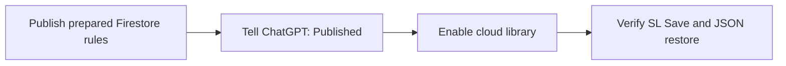

# Enable the family puzzle library

The puzzle library uses the existing Cloud Firestore database in `kidsgame-7a262`.
It stores one document per puzzle in `puzzleLibrary`.
SL can save, restore, and delete puzzles.
Approved family players can read puzzles.

## Activation status

Sean replied “publish.” after the request to confirm rule publication.
ChatGPT treated that reply as confirmation and enabled the cloud controls.
The prepared site cache is `kidsgames-v17`.
The live Firebase rules were not inspected directly.
Real Firebase Save and restore still need the check below.

## Required console step

1. Open [Firebase console for kidsgame-7a262](https://console.firebase.google.com/project/kidsgame-7a262/firestore).
2. Select **Firestore Database**.
3. Select **Rules**.
4. Keep a copy of the current rules.
5. Open the [complete prepared rules](https://raw.githubusercontent.com/seanlin-larc/kidsgames/main/firebase/firestore.rules).
6. Copy the complete file.
7. Replace the console editor contents with that file.
8. Select **Publish**.
9. Tell ChatGPT that the rules are published.

The prepared file includes the existing player, Minesweeper, and statistics rules.
The new block adds `puzzleLibrary` permissions.
Do not replace the whole ruleset with only that new block.

The application uses `players/{uid}.code == "SL"` to identify the creator on the server.
The existing player documents are maintained through the console.
Browser clients cannot change those documents.
No UID needs to be copied into the game code.

Cloud controls are enabled with `LIBRARY_ENABLED = true`.
Save keeps a device draft and attempts a cloud save when online.

## Existing settings

Use the existing `(default)` database.
Keep the existing Authentication, authorized domains, and API key settings.
The app reuses the existing signed-in Firebase session.
The first successful Save creates the collection and document automatically.

This design does not use Cloud Storage or a new backend service.
It does not need a service account key, GitHub credential, or GitHub configuration change.
Ordinary Firestore reads and writes remain subject to the project's quotas and billing plan.
Managed Firestore export is not used for the JSON archive.

## After activation

1. Sign in as SL on the game homepage.
2. Open Move The Red Locomotive.
3. Enter a puzzle name.
4. Select Save and a difficulty.
5. Check the **Puzzle saved** card.
6. Open Firestore Database → Data.
7. Check the new document in `puzzleLibrary`.

The confirmation card appears only after Firestore confirms the save.
It names the saved puzzle and stays open until dismissed.
If the later device copy fails, the card explains that separately.

Use **Open library** to load a saved puzzle on another signed-in device.
Use **New puzzle** to create a separate puzzle.
Saving a loaded puzzle updates its existing document.

### Manage library and delete duplicates

Publish the updated complete `firebase/firestore.rules` file before using deletion on the live site.
Earlier rules reject all puzzle deletions. The updated rule permits only SL to delete library documents.
Player records and game statistics keep their existing protections.

1. Sign in as SL and select Build in the workshop.
2. Select **Manage library** on the controls card.
3. Select **×** beside the duplicate puzzle.
4. Check the puzzle name in the confirmation.
5. Confirm to delete, or cancel to keep the puzzle.

The list removes the entry only after Firestore confirms deletion.
The current board and device draft stay available.
The device's cached library removes the deleted entry.
A puzzle changed on another device requires reopening Manage library before deletion.
Failed or offline requests keep the entry and show an error.
Deletion does not queue an offline request or delete any other puzzle.

Use **Download archive** to download all saved puzzles as JSON.
The archive reads current server data and requires an internet connection.
It contains puzzle IDs, names, layouts, difficulty, revisions, and date strings.
It excludes player IDs and game statistics.

Use **Restore archive** to preview a restore.
Existing puzzle IDs are kept by default.
The replacement checkbox explicitly includes matching IDs.
One transaction checks revisions before it writes any documents.
If a selected target puzzle changes after preview, the restore fails without partial writes.
Restore never deletes unrelated puzzles.

An archive supports up to 200 puzzles and 2 MB in this version.
Downloaded revisions and dates describe the exported records.
Newly restored records start at revision 1 with current server timestamps.
Replacing a record increments its current revision and retains its original creation metadata.

## Offline behavior

Offline Save keeps a device draft and reports that cloud saving needs internet.
It does not silently queue a later cloud update.
Connect and select Save again to send that draft.
The library caches a validated copy for offline reading after an online library load.
Archive download, restore, and library management always require a server connection.

## Verification boundary

Local app tests simulate family identities and Firestore SDK responses.
All seven Firestore emulator tests pass, including SL-only deletion and the 200-document restore transaction.
All 67 unit cases and both Chromium suites pass, including confirmed deletion, cancellation, errors, and phone touch controls.
Rule publication is based on Sean's earlier reply; the new deletion rule has not been published by this change.
Existing player and statistics rule text was checked against the repository and remains unchanged.
These tests do not establish that the console rules were published.
Real Firebase saving and cross-device restoration still need the activation check above.

## Sources

- [Firebase: deploy Firestore rules](https://firebase.google.com/docs/firestore/security/get-started)
- [Firebase: get document data](https://firebase.google.com/docs/firestore/query-data/get-data)
- [Firebase: transactions](https://firebase.google.com/docs/firestore/manage-data/transactions)
- [Firebase: Firestore pricing and quotas](https://firebase.google.com/docs/firestore/pricing)
